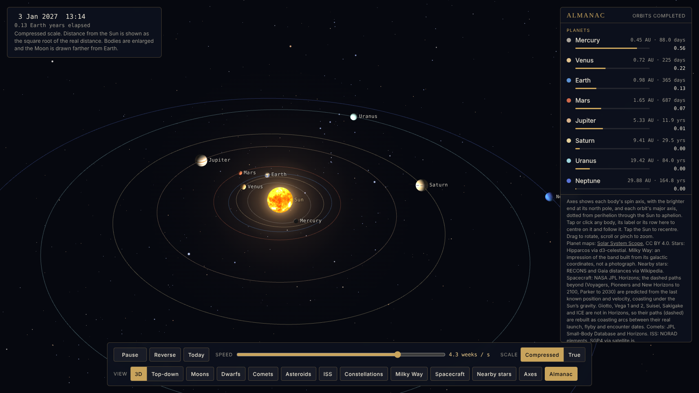

# Orrery

**[▶ Open the live orrery](https://hughesalex.github.io/orrery/orrery.html)**

An interactive 3D orrery of the solar system that runs in your browser. Watch the planets circle the Sun at their real relative speeds, so you can see at a glance how Mercury races round in 88 days while Neptune takes 165 years. Switch between a compressed scale, which keeps the whole system on screen, and true scale, which shows how vast the gaps between the outer planets really are. The almanac counts the orbits each planet completes as time runs.

You can speed time up, pause or reverse it, view from above or in 3D, and click any body to follow it. Optional layers add moons, dwarf planets, asteroids and the Kuiper belt, comets, the ISS, spacecraft paths from NASA JPL Horizons, constellations, nearby stars and the Milky Way.

It is a single HTML file with no build step. Open `orrery.html` in a browser (it loads three.js from a CDN, so it needs an internet connection).
