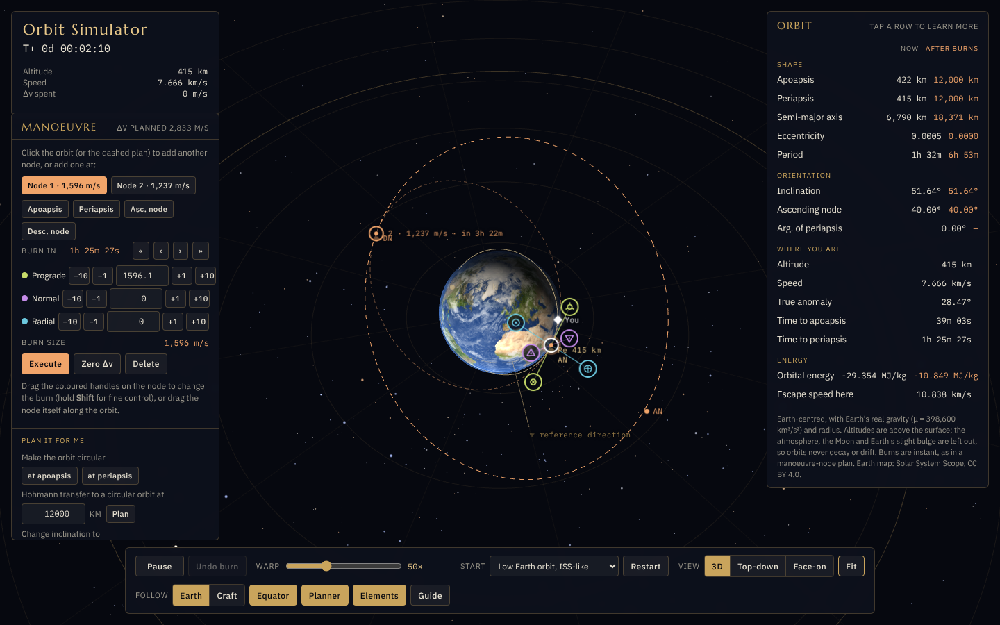

# Orbit Simulator

**[▶ Open the live orbit simulator](https://hughesalex.github.io/orrery/orbit-simulator/orbit-simulator.html)**

An interactive sandbox for learning how orbits work, in the style of the [Orrery](https://hughesalex.github.io/orrery/orrery.html).

A spacecraft circles Earth. Click anywhere on its orbit to drop a manoeuvre node, then drag the coloured handles (or use the buttons in the Manoeuvre panel) to push prograde, normal or radial, as in Kerbal Space Program. Plan up to six burns in a row: the dashed orange path shows where each one takes you, and the Orbit panel compares apoapsis, periapsis, eccentricity, inclination and the other elements now and after all the burns. Tap any row for an explanation.

- **Plan it for me** works out the burns to circularise at apoapsis or periapsis, make a Hohmann transfer to any altitude, or change inclination.
- **Fly by hand** fires the engine live while you hold a button or W/S, Q/E, D/A.
- **Undo burn** (Ctrl+Z) puts the craft back as it was before the last burn, planned or hand-flown, even after a crash, with the node back on the plan.
- **View** swings the camera to 3D, Top-down (above the North Pole) or Face-on (square to the orbit); **Fit** zooms to the whole plan; **Follow** keeps Earth or the craft in the centre.
- The **Guide** button explains the controls and suggests things to try.

Starting orbits: an ISS-like low orbit, an equatorial parking orbit, a geostationary transfer orbit, geostationary, Molniya, sun-synchronous polar, a suborbital hop and an escape trajectory.

The physics is exact two-body motion (Kepler's laws) with instant node burns. There is no air drag, no Moon and no effect of Earth's equatorial bulge yet.

## Files

`orbit-simulator.html` is the whole app: a single file that works offline. Use the [live page](https://hughesalex.github.io/orrery/orbit-simulator/orbit-simulator.html), or download the file and open it straight from disk in a browser.

It is built from `src/orbit-simulator.html` by `build.sh`, which embeds the files in `vendor/`: fonts, three.js r128 and its OrbitControls, the Earth map from Solar System Scope (CC BY 4.0), all taken from the Orrery, plus `sky.js` with the bright-star catalogue and cloud map. Edit the source, then run `bash build.sh`.
